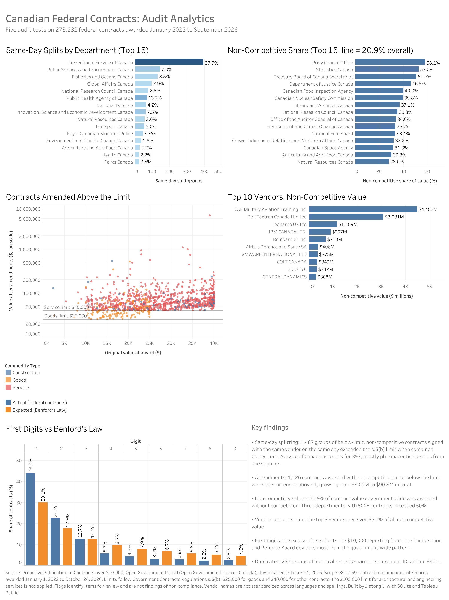

# Canadian Federal Contracts: Audit Analytics

Five audit analytics tests on 273,232 Canadian federal government contracts awarded from January 2022 to September 2026, built with SQL (SQLite) and Tableau.

**[View the interactive dashboard on Tableau Public](https://public.tableau.com/views/CanadianFederalContractsAuditAnalytics/AuditDashboard)** | **[Read the audit memo](memo/memo.md)**



## Key findings

- **Contract splitting:** 1,487 groups of below-limit, non-competitive contracts were signed with the same vendor on the same day and together exceeded the Government Contracts Regulations s.6(b) limit. Correctional Service of Canada accounts for 393 of them.
- **Amendment growth:** 1,126 contracts awarded without competition at or below the limit were later amended above it, growing from $30.0M to $90.8M.
- **Non-competitive concentration:** 20.9% of contract value government-wide was awarded without competition, and the top 3 vendors received 37.7% of that value.
- **Benford's Law:** the excess of leading 1s reflects the $10,000 reporting floor; the Immigration and Refugee Board deviates most from the government-wide pattern.
- **Duplicates:** 287 groups of identical records share a procurement ID, adding 340 likely double-reported records.

All flags are items for review, not findings of non-compliance.

## Approach

1. **Data profiling.** Checked 1,313,552 raw records for missing fields, implausible dates, invalid values and how amendments are recorded, then limited the scope to 2022 onward, when the fields needed for testing became mandatory.
2. **Cleaning.** Built a clean table of 341,159 contracts and amendments with standardized vendor keys, fiscal years and numeric fields, plus indexes for the tests.
3. **Audit tests (SQL).**

   | File | Test | Techniques |
   |---|---|---|
   | [03_test1_contract_splitting](sql/03_test1_contract_splitting.sql) | Same-day and 30-day contract splitting below the s.6(b) limit | Self-join on date ranges, `HAVING`, `GROUP_CONCAT` |
   | [04_test2_amendment_growth](sql/04_test2_amendment_growth.sql) | Contracts amended far above their original value | CTEs, `ROW_NUMBER()` and `COUNT()` window functions |
   | [05_test3_noncompetitive_concentration](sql/05_test3_noncompetitive_concentration.sql) | Non-competitive share by department and vendor | Conditional aggregation, running totals |
   | [06_test4_benford](sql/06_test4_benford.sql) | First-digit analysis against Benford's Law | String functions, mean absolute deviation |
   | [07_test5_duplicates](sql/07_test5_duplicates.sql) | Possible duplicate records | Multi-column grouping |

4. **Scorecard.** [08_dept_scorecard](sql/08_dept_scorecard.sql) combines all five tests into one row per department.
5. **Dashboard.** Five Tableau views with key findings and methodology notes.

## Repository structure

```
gov-contracts-audit/
├── data/output/     Tables exported for the dashboard (CSV)
├── sql/             Profiling, cleaning, five tests and scorecard (01 to 08)
├── tableau/         Dashboard screenshot
└── memo/            Audit memo with data quality notes and limitations
```

## How to reproduce

The raw file (about 640 MB) and the SQLite database are not stored here because they exceed GitHub's file size limit.

1. Download **Contracts over $10,000** (contracts.csv) from the [Open Government Portal](https://open.canada.ca/data/en/dataset/d8f85d91-7dec-4fd1-8055-483b77225d8b).
2. In [DB Browser for SQLite](https://sqlitebrowser.org/), create a database and import the CSV as a table named `contracts_raw`.
3. Run the files in `sql/` in order, from `01` to `08`.

Results will differ slightly if the source data has been updated since October 24, 2026.

## Data source and licence

Contains information licensed under the [Open Government Licence - Canada](https://open.canada.ca/en/open-government-licence-canada).

## Author

Jiatong Li, Financial Analysis and Risk Management, University of Waterloo
